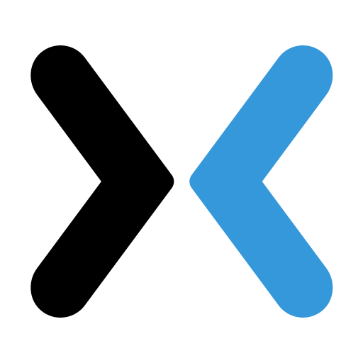
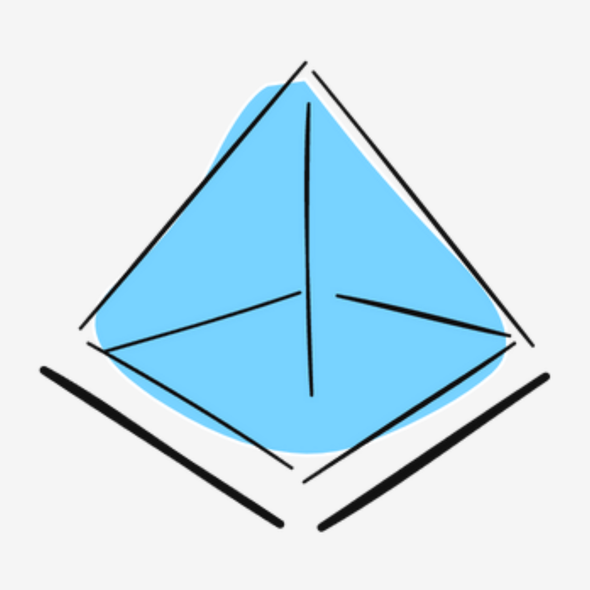
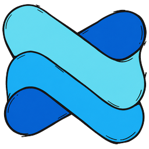
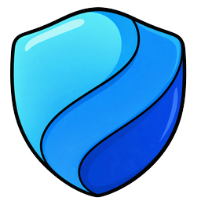
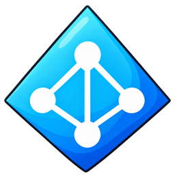

<section class="sp-hero">
  

    
 Sponsor my work

    <h1>Free tools for the Microsoft community, <em>funded by the people who use them.</em></h1>
    
I build Maester, Lokka, idPowerToys, cmd.ms, Graph X-Ray and more, and give them away. There is no company or investor behind them. If they save you time, you can help me keep building.

    

      <a class="sp-btn sp-btn-flame" href="https://github.com/sponsors/merill">Sponsor on GitHub</a>
      <a class="sp-btn sp-btn-ghost" href="#ways">See all three ways</a>
    

  

  

    
<i></i><i></i><i></i>pwsh

    

      
<b>PS&gt;</b> Invoke-Maester -Path ./merill -Tag Funding

      
✓ PassedME.1001Tools are free and open source

      
✓ PassedME.1002Mission: keep building Maester

      
✓ PassedME.1003Kids to feed: 4

      
✓ PassedME.1004Mortgage: present

      
✗ FailedME.1005Investors or outside funding: none found

      
Remediation: <a href="#ways">become a sponsor</a>

      
Tests: 5 · Passed: 4 · Failed: 1

    

  

</section>

<section class="sp-stats" aria-label="How much the tools are used">
  
<strong>{{ site.data.stats.psgallery.Maester.display | default: "625k" }}</strong>Maester installs

  
<strong>{{ site.data.stats.cloudflare["graphpermissions.merill.net"].display | default: "1.8m" }}+</strong>views across my sites

  
<strong>{{ site.data.stats.cloudflare["cmd.ms"].display | default: "155k" }}</strong>monthly visits to cmd.ms

  
<strong>20K</strong>weekly Entra.News subscribers

</section>

<section class="sp-note">
  

    
Why I'm asking

    
No investors.One mission.

    
Keep building Maester and free tools for the Microsoft community.

    

      
How the free work is paid for

      <ul>
        <li><strong>Maester Cloud</strong></li>
        <li><strong>Ad sponsors</strong>on Entra.News and Entra.Chat</li>
        <li><strong>Sponsors like you</strong>on GitHub and through your company</li>
      </ul>
    

  

  

    
I spent years on the Microsoft Entra product team. In 2026 I left to build tools for this community full time.

    
I give away most of what I build, and I want to keep it that way. <strong>None of the free work has outside funding.</strong> I pay for the hosting, the test tenants and the Microsoft licences myself.

    
I support myself through paid work that sits alongside the free tools: <a href="https://maester.cloud">Maester Cloud</a> and <a href="https://sponsors.admin.news">ad sponsors</a> on the newsletters and podcast. Sponsorship is the part that pays for the time I spend on everything that stays free.

    
It isn't only the tools. I write <a href="https://entra.news">Entra.News</a> every week, host the <a href="https://entra.chat">Entra.Chat</a> podcast, and post what I learn about Entra, security and Graph on <a href="https://www.linkedin.com/in/merill">LinkedIn</a> and <a href="https://x.com/merill">X</a>. If something I shared taught you something and you'd like to give back, this is how.

    
I also have a mortgage and four kids, so this work has to pay its way if I'm going to keep doing it.

    
My mission is to keep building Maester and keep helping the Microsoft community. If my tools save you or your team time, sponsoring is how you keep them coming.

    

      
      
<strong>Merill Fernando</strong>Maintainer of Maester · ex-Microsoft Entra PM · Melbourne

    

  

</section>

<section id="ways">
  
Three ways to sponsor

  <h2 class="sp-h2">Pick the one that fits you.</h2>
  
A coffee from one admin, a subscription for a team, or a company backing the project. All three keep the tools free for everyone else.

  

    

      
For individuals and teams

      <h3><svg viewBox="0 0 16 16" aria-hidden="true"><path fill="#bf3989" d="m8 14.25.345.666a.75.75 0 0 1-.69 0l-.008-.004-.018-.01a7.152 7.152 0 0 1-.31-.17 22.055 22.055 0 0 1-3.434-2.414C2.045 10.731 0 8.35 0 5.5 0 2.836 2.086 1 4.25 1 5.797 1 7.153 1.802 8 3.02 8.847 1.802 10.203 1 11.75 1 13.914 1 16 2.836 16 5.5c0 2.85-2.045 5.231-3.885 6.818a22.066 22.066 0 0 1-3.744 2.584l-.018.01-.006.003h-.002ZM4.25 2.5c-1.336 0-2.75 1.164-2.75 3 0 2.15 1.58 4.144 3.365 5.682A20.58 20.58 0 0 0 8 13.393a20.58 20.58 0 0 0 3.135-2.211C12.92 9.644 14.5 7.65 14.5 5.5c0-1.836-1.414-3-2.75-3-1.373 0-2.609.986-3.029 2.456a.749.749 0 0 1-1.442 0C6.859 3.486 5.623 2.5 4.25 2.5Z"/></svg> GitHub Sponsors</h3>
      
from<strong>$5</strong>/ month, or a one-off

      
Learned something from a post, the newsletter or the podcast? Shout me a coffee, or sponsor every month.

      <ul>
        <li><b>$5</b> Coffee fuel. A sponsor badge and your avatar on the <a href="#wall">sponsor wall on merill.net</a>.</li>
        <li><b>$15</b> Admin's thank-you. A larger avatar on the sponsor wall.</li>
        <li><b>$100</b> Company sponsor. Your logo on the sponsor wall and the tool READMEs.</li>
        <li><b>$500</b> Lead sponsor. A large logo at the top of the sponsor wall.</li>
      </ul>
      <a class="sp-btn sp-btn-ink" href="https://github.com/sponsors/merill">Sponsor on GitHub</a>
      
A donation to my open source work. It doesn't include Maester Cloud.

    

    

      
For teams that run Maester

      <h3> Maester Cloud</h3>
      
from<strong>$99</strong>/ month

      
Sponsor Maester and get a product in return. Maester Cloud runs Maester for you and keeps the history.

      <ul>
        <li>Deploys into your own Azure subscription.</li>
        <li>Posture across all your tenants, with history for every check.</li>
        <li>Shows what drifted between runs and alerts you when it changes.</li>
        <li>Every subscription funds new checks, docs and fixes in open source Maester.</li>
      </ul>
      <a class="sp-btn sp-btn-flame" href="https://maester.cloud/pricing">Get Maester Cloud</a>
      
Open to companies and individuals. <a href="https://maester.cloud">maester.cloud</a>

    

    

      
For companies that rely on Maester

      <h3> Company sponsor</h3>
      
<strong>Let's talk</strong>

      
Sponsor my time on Maester directly. In return you get logo placement and a bigger say in what gets built.

      <ul>
        <li>Pays for maintainer time on checks, releases and reviews.</li>
        <li>Your logo on the Maester home page, sponsor page and README.</li>
        <li>A bigger say in the Maester backlog and what I work on next.</li>
      </ul>
      <a class="sp-btn sp-btn-outline" href="mailto:merill@merill.net?subject=Sponsoring%20Maester">Email me</a>
      
Write to <a href="mailto:merill@merill.net?subject=Sponsoring%20Maester">merill@merill.net</a> and tell me a little about your company.

    

  

  
<strong>Looking to advertise instead?</strong> Newsletter ads across Admin.News, including Entra.News, are booked at <a href="https://sponsors.admin.news">sponsors.admin.news</a>.

</section>

<section>
  
Where it goes

  <h2 class="sp-h2">What your sponsorship pays for.</h2>
  

    

      <h3>My time</h3>
      
Writing checks, reviewing pull requests, shipping releases and answering the community.

    

    

      <h3>Test tenants and licences</h3>
      
Maester checks are verified against real tenants, and those tenants need Microsoft licences.

    

    

      <h3>Hosting</h3>
      
The servers and domains behind the free sites, so they stay fast and free of ads.

    

  

</section>

<section>
  
What you're backing

  <h2 class="sp-h2">Tools and teaching you may already rely on.</h2>
  
Free tools, a weekly newsletter, a podcast, and the posts I share on LinkedIn and X to help you learn Entra, security and Graph.

  

    <a class="sp-tool" href="https://maester.dev">
<strong>Maester</strong>Security testing for Microsoft 365
</a>
    <a class="sp-tool" href="https://lokka.dev">
<strong>Lokka</strong>MCP server for Microsoft Graph
</a>
    <a class="sp-tool" href="https://idpowertoys.merill.net">
<strong>idPowerToys</strong>Conditional Access visualizer
</a>
    <a class="sp-tool" href="https://cmd.ms">
<strong>cmd.ms</strong>Your Microsoft Cloud command line
</a>
    <a class="sp-tool" href="https://graphxray.merill.net">
<strong>Graph X-Ray</strong>Portal clicks to Graph scripts
</a>
    <a class="sp-tool" href="https://graphpermissions.merill.net">
<strong>Graph Permissions Explorer</strong>What each Graph permission exposes
</a>
    <a class="sp-tool" href="https://getyako.com">
<strong>Yako</strong>Start page for Microsoft admins
</a>
    <a class="sp-tool" href="https://aka.ms/msid">
<strong>MSIdentityTools</strong>PowerShell cmdlets for Entra
</a>
    <a class="sp-tool" href="https://entra.news">
<strong>Entra.News</strong>Weekly newsletter, 20K subscribers
</a>
    <a class="sp-tool" href="https://entra.chat">
<strong>Entra.Chat</strong>Podcast with the people behind Entra
</a>
    <a class="sp-tool" href="https://admin.news">
<strong>Admin.News</strong>Weekly and daily newsletters, 34K+ subscribers
</a>
    <a class="sp-tool" href="https://intune.admin.news">
<strong>Intune News</strong>Weekly Intune roundup
</a>
    <a class="sp-tool" href="https://defender.admin.news">
<strong>Defender News</strong>Weekly Defender and Sentinel roundup
</a>
    <a class="sp-tool" href="https://ad.admin.news">
<strong>AD News</strong>Weekly Active Directory roundup
</a>
    <a class="sp-tool" href="https://purview.admin.news">
<strong>Purview News</strong>Weekly Purview roundup
</a>
    <a class="sp-tool" href="https://msai.ms">
<strong>Microsoft AI News</strong>Weekly Microsoft AI and Copilot roundup
</a>
    <a class="sp-tool" href="https://www.linkedin.com/in/merill"><i class="fab fa-linkedin-in" aria-hidden="true"></i>
<strong>Posts on LinkedIn</strong>Tips and explainers, 50K followers
</a>
    <a class="sp-tool" href="https://x.com/merill"><i class="fab fa-twitter" aria-hidden="true"></i>
<strong>Posts on X</strong>Tips and explainers, 21K followers
</a>
    <a class="sp-tool" href="/">
<strong>And many more</strong>See everything on merill.net
</a>
  

</section>

<section id="wall">
  
  
  
Sponsor wall

  <h2 class="sp-h2">Thank you to the {{ wall_total }} sponsors backing this work.</h2>
  
Everyone who sponsors Maester, subscribes to Maester Cloud or sponsors me on GitHub, and chose to be listed. Updated daily.

  
  <h3 class="sp-wall-group">Company sponsors</h3>
  

    
    
    
  

  

  
  <h3 class="sp-wall-group">Maester Cloud supporters {{ wall.cloud.size }}</h3>
  

    
    {{ s.initials | escape }}{{ s.name | escape }}
    
    <a class="sp-member" href="{{ s.url | escape }}" rel="noopener nofollow">{{ inner }}</a>
    
    
{{ inner }}

    
    
    <a class="sp-member sp-member-you" href="https://maester.cloud/pricing">+Your name here</a>
  

  

  <h3 class="sp-wall-group">GitHub sponsors {{ wall.github.size }}</h3>
  

    
    
    
    <a class="sp-member sp-member-lg sp-member-round" href="{{ s.website | default: s.url | escape }}" rel="noopener nofollow">{{ s.name | escape }}</a>
    
    <a class="sp-member sp-member-you" href="https://github.com/sponsors/merill">+Your name here</a>
  

</section>

<section class="sp-close">
  

    <h2>Keep the tools free for everyone.</h2>
    
Can't sponsor right now? Starring <a href="https://github.com/maester365/maester">Maester on GitHub</a> or telling a colleague about a tool helps too.

  

  

    <a class="sp-btn sp-btn-flame" href="https://github.com/sponsors/merill">Sponsor on GitHub</a>
    <a class="sp-btn sp-btn-ghost" href="https://maester.cloud/pricing">Get Maester Cloud</a>
  

</section>

